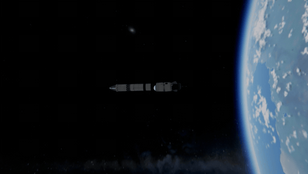

# Steady Camera

The flight camera held steady while your craft spins.

The game turns its flight camera a little more the faster the craft spins, about the spin's own axis (a "wobble",
set by `FLT_CAMERA_WOBBLE` in the game's settings). In a fast spin that turn is large and swings about with the craft,
and the picture shakes. Steady Camera holds it back: all of it as installed, or as much as you like.

For Kerbal Space Program 1.12.x. **Needs [Keystone](https://github.com/IshiakiZ/ksp-keystone)**, a separate download
([on SpaceDock](https://spacedock.info/mod/4665/Keystone)): this mod does not load without it.

## Install

Copy the `SteadyCamera` folder from the download into your KSP's `GameData`, beside `Keystone`.

## Use

It is on as installed. In the Keystone window (the keystone button on the game's toolbar, or Alt-K; Option-K on a
Mac), under **Steady Camera**: the switch **Steady camera**, **Wobble kept** (0 none, 1 the game's own), and **Glide to
what it follows next** (0.2.0): when the camera changes what it follows (a kerbal stepping out, another craft near by
taken over, a part aimed at), the game puts it there at once and the picture jumps; with this on it glides there over
0.6 s (not over more than 150 m). **Engines' shake kept** and **In the cockpit** (0.2.0): how much of the game's own
camera shake (its engines' rumble, a solid booster's most, and the air's buffeting) is kept, outside and in the cockpit
view (1, as the game has it, as installed). The window also says how fast the craft is spinning, how far the game would have
turned the view for it, and how far the last glide went.

## Good to know

* Your game's settings file is not changed: switch the mod off and the camera is the game's own again.

## Works on

Mac: tried. Windows 11: 0.1.0 tried (a craft spinning in orbit: the wobble held back); what 0.2.0 adds, not yet.
Linux: never run.

**More:** [how it works](https://github.com/IshiakiZ/ksp-steady-camera/wiki/How-it-works) and the rest of the [wiki](https://github.com/IshiakiZ/ksp-steady-camera/wiki).

## Licence

[CC BY 4.0](LICENSE): use it, change it and pass it on as you like, as long as you credit Ishiaki and link back here.
